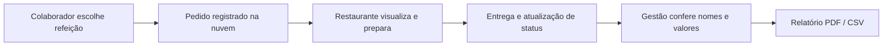

<div align="center">


# RL Pedidos | Gestão de Refeições em Obras

**Uma solução digital da RL Engenharia para organizar café da manhã, almoço, restaurante e conferência financeira em canteiros de obras.**

**Projeto-piloto: obra AMBEV, Itapissuma — Pernambuco.**

[**Conhecer a solução**](https://lionzionion.github.io/pedidos-almoco-Rlconstrucoes/) · [**Acessar o aplicativo**](https://lionzionion.github.io/pedidos-almoco-Rlconstrucoes/acesso/) · [**Testar demonstração**](https://lionzionion.github.io/pedidos-almoco-Rlconstrucoes/demo/)


</div>

---

## O problema

Em uma obra, os pedidos de refeições frequentemente são feitos em conversas individuais e grupos de mensagens. Quando chega a hora de pagar o restaurante, a gestão precisa conferir manualmente **quem pediu, o que pediu, quanto foi entregue e quanto deve ser cobrado**.

Isso pode gerar duplicidade, cancelamentos sem registro, dificuldade de planejar a produção e divergências na conferência.

## A solução

O **RL Pedidos** centraliza toda a operação em um aplicativo web responsivo, acessível por celular ou computador, com três perfis e dados compartilhados em um banco na nuvem.

| Perfil | O que faz |
|---|---|
| 👷 **Colaborador** | Entra com usuário e senha, escolhe café ou almoço no cardápio do dia, personaliza acompanhamentos, confirma, consulta e cancela pedidos enquanto permitido. |
| 🍽️ **Restaurante** | Visualiza pedidos recebidos, nomes, acompanhamentos e observações; atualiza o estado para **em preparo** e **entregue**; imprime o mapa de produção. |
| 📊 **Administração RL** | Cadastra e gerencia usuários, acompanha todos os pedidos, identifica cancelamentos, confere preços e taxas, emite relatórios PDF e exporta dados. |

### Fluxo operacional



## Acesse o projeto

| Destino | Endereço | Indicação |
|---|---|---|
| **Portal do produto** | [rl-pedidos · apresentação](https://lionzionion.github.io/pedidos-almoco-Rlconstrucoes/) | Apresentações, portfólio e demonstração da solução |
| **Acesso único** | [Entrar no RL Pedidos](https://lionzionion.github.io/pedidos-almoco-Rlconstrucoes/acesso/) | Colaboradores, restaurante e administração |
| **Demo interativa** | [Explorar versão fictícia](https://lionzionion.github.io/pedidos-almoco-Rlconstrucoes/demo/) | Testes e apresentações sem alterar o banco real |
| **Aplicação original** | [Rota técnica do aplicativo](https://lionzionion.github.io/pedidos-almoco-Rlconstrucoes/app/) | Mesmo sistema autenticado |
| **Formulário histórico** | [Versão anterior preservada](https://lionzionion.github.io/pedidos-almoco-Rlconstrucoes/legado/) | Compatibilidade e registro da evolução do projeto |

**Importante:** o aplicativo utiliza autenticação e está em **fase de homologação operacional**. A demonstração é isolada, utiliza dados fictícios e não envia pedidos ao restaurante.

## Principais funcionalidades

- **Cardápio por dia da semana:** rodízio de café da manhã e almoço, de segunda a domingo.
- **Personalização de refeições:** escolha do prato, acompanhamentos, observações e restrição de dois feijões simultâneos.
- **Controle de pedidos:** confirmação, edição e cancelamento antes do preparo; arquivamento administrativo com histórico.
- **Gestão de acessos:** criação de contas com nomes de usuário, **senha forte gerada automaticamente**, redefinição e troca de senha, desativação e exclusão de contas sem pedidos. O ADM pode promover um colaborador ativo a **Administrador (ADM)** e reverter a permissão; a conta principal e a própria conta ficam protegidas.
- **Painel do restaurante:** lista de produção, status de preparo/entrega e visualização de cancelamentos.
- **Chat privado em tempo real:** colaborador ↔ restaurante/gestão e uma conversa reservada entre RL e restaurante.
- **Limpeza protegida de testes:** ADM pode zerar pedidos, histórico operacional de pedidos e mensagens após prévia e dupla confirmação, sem apagar contas ou logs de segurança.
- **Conferência financeira:** total das refeições e **uma única taxa de R$ 8 por remessa**, aplicada somente após o fechamento do café às **08h** e do almoço às **13h**, horário de Recife.
- **Relatórios:** PDF A4 com logo RL, impressão, CSV e resumo consolidado para envio manual por WhatsApp.
- **Dados centralizados:** PostgreSQL na nuvem, autenticação Supabase, políticas de acesso por linha (RLS), auditoria e atualização em tempo real.

### Regras de preço do projeto-piloto

| Item | Valor |
|---|---:|
| Café completo | R$ 17,00 |
| Café simples com pão | R$ 10,00 |
| Almoço | R$ 22,00 |
| Entrega coletiva de café (uma vez no fechamento às 08h) | R$ 8,00 |
| Entrega coletiva de almoço (uma vez no fechamento às 13h) | R$ 8,00 |

*Valores da operação de referência em novembro de 2026. Exemplo: 10 almoços a R$ 22 = R$ 220 + **somente R$ 8 de entrega** = R$ 228. Os pedidos são bloqueados após seu horário de corte; a taxa não é multiplicada por colaborador. Remessas extras exigem definição separada.*

## Arquitetura e tecnologias

```text
GitHub Pages
  ├── Portal comercial             / e /produto/
  ├── Acesso único                 /acesso/
  ├── Interface autenticada        /app/
  └── Demonstração local           /demo/
            |
            v
       Supabase Auth
            |
            v
Supabase PostgreSQL + Row Level Security
  ├── profiles        usuários e permissões
  ├── orders          refeições, status e valores
  ├── order_audit     histórico de alterações
  └── account_audit   ações administrativas
            |
            +── Realtime: atualizações de pedidos
            +── Edge Function: manage-users (criação e gestão de contas)
            +── Browser: PDF / impressão / CSV
```

**Stack:** HTML5, CSS3, JavaScript, Supabase Auth, PostgreSQL, Row Level Security (RLS), Supabase Realtime, Supabase Edge Functions, jsPDF, jsPDF-AutoTable e GitHub Pages.

### Segurança e dados

- Os funcionários não precisam informar e-mail pessoal: a administração cria **login e senha individuais** usando um identificador interno no serviço de autenticação.
- Somente o perfil **ADM ativo** pode conceder contas de colaborador/restaurante. Senhas e credenciais privilegiadas **não são expostas no código do navegador**.
- O aplicativo utiliza apenas uma **chave publicável** do Supabase; funções privilegiadas rodam no servidor.
- Pedidos cancelados e arquivados são preservados para auditoria e não entram no valor ativo da conferência.
- O GitHub público contém o código da aplicação, **não os pedidos ou senhas dos colaboradores**.

> Armazenamento na nuvem não substitui política de backup. Antes de uso definitivo, é necessário validar rotinas de recuperação, fluxos operacionais e critérios de cobrança.

## Estrutura do repositório

```text
.
├── index.html                      Portal oficial do produto
├── acesso/index.html               Entrada única dos usuários
├── app/                            Frontend autenticado e relatórios
├── produto/                        Página comercial detalhada
├── demo/                           Simulação isolada com dados fictícios
├── legado/                         Formulário histórico preservado
├── assets/                         Logomarca e recursos visuais
├── supabase/
│   ├── schema.sql                  Estrutura inicial e RLS
│   ├── realtime.sql                Atualizações dos pedidos
│   ├── managed-accounts.sql        Perfis e permissões
│   └── functions/manage-users/     Gestão segura de usuários
├── docs/                           Manuais, arquitetura e implantação
├── tests/                          Testes de regras, login e relatórios
└── README.md
```

## Como testar

### Demonstração para portfólio

1. Abra [a demonstração](https://lionzionion.github.io/pedidos-almoco-Rlconstrucoes/demo/).
2. Escolha **Colaborador**, monte uma refeição e registre um pedido fictício.
3. Alterne para **Restaurante** e acompanhe as solicitações.
4. Abra **Gestão RL** para visualizar o fechamento e a relação nominal.

A demo não grava dados no Supabase real.

### Desenvolvimento local

```bash
git clone https://github.com/lionzionion/pedidos-almoco-Rlconstrucoes.git
cd pedidos-almoco-Rlconstrucoes
python -m http.server 8000
```

Abra `http://localhost:8000/`. Para rodar testes de regras e estrutura (Node.js instalado):

```bash
node --test tests/*.test.cjs
```

A publicação do frontend é estática. Para usar outro projeto Supabase, configure `app/config.js` com URL e **chave publicável**, depois aplique as migrações conforme [documentação técnica](docs/03-ARQUITETURA-E-SEGURANCA.md). **Nunca publique chaves secretas ou de serviço.**

## Documentação

- [Visão geral e estudo de caso](docs/01-VISAO-GERAL.md)
- [Guia de uso: colaborador, restaurante e administração](docs/02-GUIA-USO.md)
- [Arquitetura, banco de dados e segurança](docs/03-ARQUITETURA-E-SEGURANCA.md)
- [Implantação e roteiro de apresentação](docs/04-IMPLANTACAO-E-APRESENTACAO.md)
- [Links e mensagem para compartilhar com a equipe](docs/05-COMPARTILHAR-ACESSO.md)
- [Identidade do repositório e configuração do GitHub](docs/06-GITHUB-PERFIL.md)

## Status e próximos marcos

| Área | Situação |
|---|---|
| Interface responsiva e cardápios | Implementado |
| Contas e permissões de colaborador, restaurante e ADM | Implementado; testes de campo pendentes |
| Painel de restaurante e conferência | Implementado; homologação pendente |
| Relatórios PDF, impressão e CSV | Implementado; validação nos dispositivos pendente |
| Backups testados e rotina de recuperação | Pendente |
| Horários de corte, remessas múltiplas e fechamento ampliado | Evolução prevista |

**Projeto desenvolvido para resolver uma necessidade concreta da operação em obra, unindo engenharia, gestão e desenvolvimento de software.**

<div align="center"><sub>RL Engenharia · Fazendo Acontecer · Pernambuco, Brasil</sub></div>

### Comunicação, senhas e limpeza pós-teste

No aplicativo, abra **Chat do restaurante** para mensagens privadas. Colaboradores veem apenas sua conversa; restaurante/ADM selecionam o funcionário ou a conversa reservada da gestão.

Em **Cadastros**, o ADM gera senhas fortes e visualiza a credencial **somente no momento de sua criação/redefinição**. As senhas anteriores não são recuperáveis do Supabase Auth. Cada usuário altera sua própria senha em **Minha senha**.

Depois da homologação, o ADM pode usar **Verificar dados → Apagar pedidos e conversas de teste**, confirmando a operação e digitando **ZERAR TESTES**. A limpeza é irreversível e **remove dados operacionais, não os cadastros, a trilha administrativa ou os logs de infraestrutura**. Não use após iniciar pedidos reais sem antes exportar/conferir os dados.


## Operação compartilhada RL Construções + Solutio

O projeto atende **uma única obra e um único restaurante**, mas os pedidos de cada colaborador são associados à sua empresa no momento em que são feitos. O vínculo de empresa é **definido pela administração** e permanece gravado no pedido, evitando que uma alteração posterior no cadastro mude o faturamento histórico.

Na **Conferência RL**, selecione `RL Construções`, `Solutio` ou `RL + Solutio`. Os totais e relatórios PDF/CSV podem ser emitidos individualmente, enquanto o restaurante conserva a **lista conjunta de produção**, com cada empresa identificada.

O frete é **R$ 8 por evento de café** (após 08h) e **R$ 8 por evento de almoço** (após 13h). Cada evento é repartido **proporcionalmente ao número de pedidos ativos de cada empresa** em centavos. Exemplo de 10 almoços RL e 7 Solutio: RL R$ 4,71 e Solutio R$ 3,29, somando exatamente R$ 8. Cancelados e arquivados não participam do rateio.

### Convites individuais e primeiro acesso

Os trabalhadores recebem convites privados, **de uso único e validade limitada**, enviados pelo ADM individualmente. O link abre a página `/convite/` e **não contém senha**. O colaborador gera ou define uma senha forte, ativa seu cadastro e entra automaticamente. O código do convite é mantido como hash no banco, e os tokens de distribuição **não ficam no GitHub**. Após a ativação, os próximos acessos são feitos pelo login comum em `/acesso/`.

Convites pendentes não equivalem a contas já ativadas: a conta só aparece como usuário no painel ADM após o primeiro acesso. O perfil inicial é `colaborador`, com empresa e função atribuídas pelo administrador. O acesso ADM existente é preservado.

### Modo de testes: pedidos sem restrição de horário (15/11/2026)

Durante a homologação, **não existe horário de bloqueio para criar, editar ou cancelar pedidos confirmados**. O corte original das 08h (café) e 13h (almoço) está temporariamente desativado no gatilho do Supabase e na interface. **A taxa única de R$ 8 por evento permanece**, contabilizada na conferência a partir de 08h/13h e rateada proporcionalmente entre RL/Solutio. Portanto, durante os testes, pedidos feitos mais tarde podem alterar o total da remessa. Antes da operação oficial, restabeleça o bloqueio de horários e confirme a regra de frete.

Em **Cadastros → Convites de primeiro acesso**, a administração pode escolher um nome já listado (por exemplo, `jackeline.tecnica`) e clicar em **Gerar link para WhatsApp**. Isso **substitui o código anterior** por outro, sem expor senha, e abre as opções **Copiar link** e **Enviar por WhatsApp**. Convites ativados não podem ser regenerados; para esses usuários, use a redefinição de senha.
