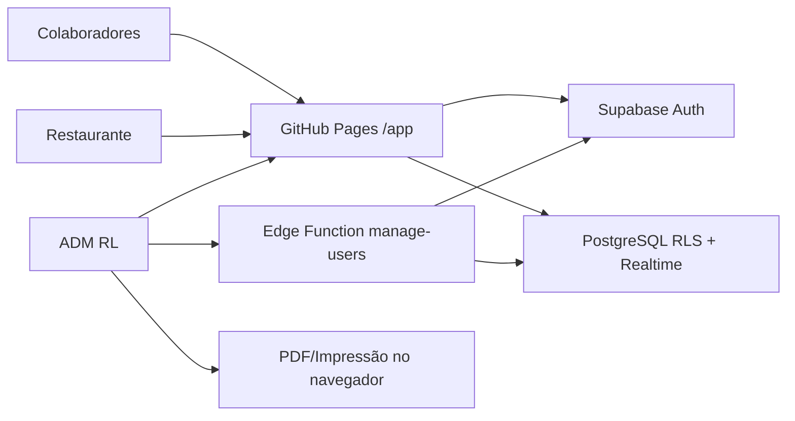

# Arquitetura e segurança do AMBEV Pedidos RL

## Fluxo

## Camadas

- **Interface:** HTML/CSS/JS responsivo. PDF via jsPDF/AutoTable; impressão nativa como alternativa.
- **Autenticação:** e-mail/senha para primeiro administrador; colaboradores e restaurante com `username` e senha. Contas gerenciadas possuem e-mail **técnico interno**, criado no servidor, sem exigir e-mail pessoal.
- **Banco:** projeto Supabase dedicado `dpmofhdaefcqxohuhkfr`, PostgreSQL com políticas RLS, triggers de preço e cardápio, auditoria de pedidos.
- **Controle de contas:** Edge Function `manage-users` protegida por autenticação de JWT e verificação de `role='admin'` + `active=true`, executando operações privilegiadas apenas no backend.
- **Comunicação:** alterações de pedidos transmitidas com `supabase_realtime`; a interface também oferece atualização manual/periódica.

## Dados

- `profiles`: `id`, `display_name`, `role`, `username` (opcional para ADM legado), `active`, `created_at`.
- `orders`: pedido, data em Recife, refeição, prato, acompanhamentos, status, cancelamento, arquivamento, preço.
- `order_audit`: cópias do estado anterior/novo do pedido.
- `account_audit`: registro de criação, ativação, desativação, troca de perfil e redefinição de senha **sem guardar a senha**.

## Proteções

1. Todas as tabelas expostas têm **RLS ativada**.
2. Sem permissão administrativa, usuário vê somente seus pedidos; restaurante vê pedidos para preparo; ADM pode conferir tudo.
3. **Contas inativas** não conseguem consultar/gravar pedidos, mesmo que consigam autenticar.
4. **Cadastro público não autoriza acesso**: contas criadas fora da gestão começam inativas.
5. O primeiro ADM foi ativado somente depois de conferir e-mail e identidade do cadastro.
6. **Nunca** colocar `SUPABASE_SERVICE_ROLE_KEY` ou secret key em GitHub Pages. A função usa chave apenas em seu ambiente Supabase.
7. O endpoint `manage-users` é disponibilizado com `verify_jwt=false` porque usa verificação explícita do JWT de usuário **dentro da função**; também confere papel ADM no banco antes de executar qualquer operação.
8. Nenhuma senha é enviada para os relatórios ou log de auditoria. Senha esquecida é redefinida, não recuperada.
9. Relatórios são gerados **no navegador autenticado**, não publicados no GitHub.
10. `/demo/` é isolado do banco e tem dados fictícios.

## Arquivos de instalação

- `supabase/schema.sql`: base do banco.
- `supabase/realtime.sql`: publicação de pedidos em tempo real.
- `supabase/managed-accounts.sql`: migração de usuário, status ativo e auditoria.
- `supabase/functions/manage-users/index.ts`: API de gestão de contas.

## Limitações conhecidas

- Ainda não foram realizados testes end-to-end com funcionário e restaurante reais em dois dispositivos. A implantação operacional depende de homologação.
- Os relatórios são por **dia** e refeição. Relatórios semanais/mensais com fechamento de múltiplas remessas estão previstos para a evolução.
- O banco Supabase faz persistência na nuvem; o plano de backup/restauração deve ser definido e testado separadamente.
- A configuração Auth atual indica **proteção contra senhas vazadas desativada**; habilitar se o plano permitir.
