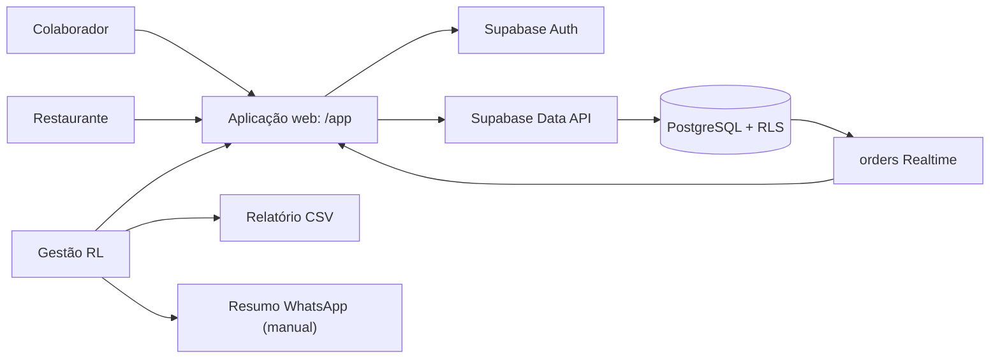

# Arquitetura, Dados e Segurança

## Arquitetura



### Tecnologia

- Frontend: HTML, CSS e JavaScript puro, sem dependência de Node em produção.
- Hospedagem: GitHub Pages, ramo `main`.
- Backend/Banco: Supabase PostgreSQL com API e autenticação.
- Eventos: `postgres_changes` na tabela `orders` mais atualização periódica.
- Testes de regra de negócio: `node --test tests/menu.test.cjs`.

### Diretórios do repositório

```
/
├── index.html                 # formulário legado preservado
├── app/                       # app com banco de dados real
│   ├── index.html
│   ├── styles.css
│   ├── menu.js
│   ├── app.js
│   └── config.js              # apenas URL e chave publishable
├── demo/                      # simulação desconectada, dados fictícios
│   ├── index.html
│   ├── styles.css
│   ├── menu.js
│   ├── app.js
│   └── config.js
├── produto/                   # site vitrine de apresentação
│   ├── index.html
│   └── style.css
├── supabase/
│   ├── schema.sql
│   └── realtime.sql
├── docs/
└── tests/menu.test.cjs
```

## Modelo de dados

**profiles**
- `id` → `auth.users.id`, nome e `role` (`colaborador`, `restaurante`, `admin`).

**orders**
- Dono do pedido, nome, data no fuso Recife, tipo de refeição, prato, acompanhamentos, observações, preço, status, motivo de cancelamento e flag de arquivamento.

**order_audit**
- Registra inclusão/atualização com identidade do ator, estado anterior e novo estado.

## Segurança

- As tabelas `profiles`, `orders` e `order_audit` possuem RLS.
- O colaborador vê seus próprios pedidos. O restaurante vê pedidos para produção. O administrador vê a conferência completa.
- A autorização é feita no banco, não pela interface ou pelo campo de nome informado no cliente.
- O frontend utiliza **somente uma chave publicável** do Supabase. Nunca use `service_role`/`sb_secret` em HTML/JS publicado.
- Preços, datas e rodízio são validados por trigger no banco antes de gravar, mesmo que alguém tente alterar o HTML.
- A remoção na interface é um **arquivamento lógico** auditado. Não há endpoint de exclusão física de pedidos para usuários.
- O ambiente `/demo/` guarda dados de exemplo no `localStorage` do dispositivo e não usa o banco de produção.

## Validações adicionais para produção

1. Testar autorização real de cada papel com três contas independentes e verificar que usuário comum não vê pedidos de terceiros.
2. Configurar URLs de confirmação de e-mail em Supabase Auth.
3. Definir política de cadastro de colaboradores da RL e desligamento de usuários.
4. Confirmar o procedimento para dados pessoais e necessidade de exclusão definitiva segundo requisitos legais.
5. Testar fluxo de pedido duplicado, cancelamento antes/depois do preparo e fechamento por dia, especialmente nos fins de semana.
6. Conferir atualizações Realtime e compatibilidade da versão publicada com o Supabase.
